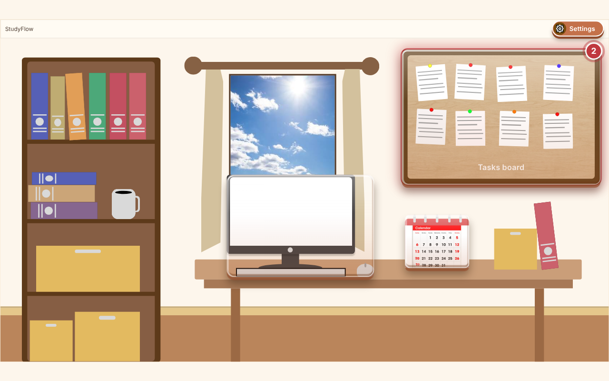
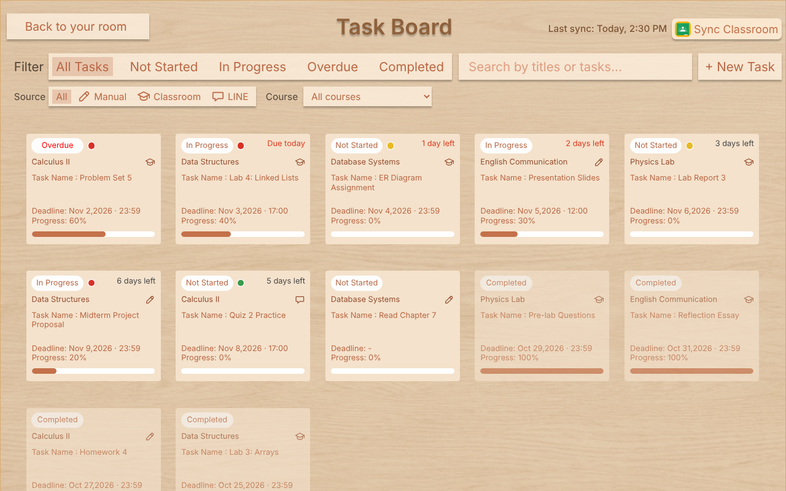
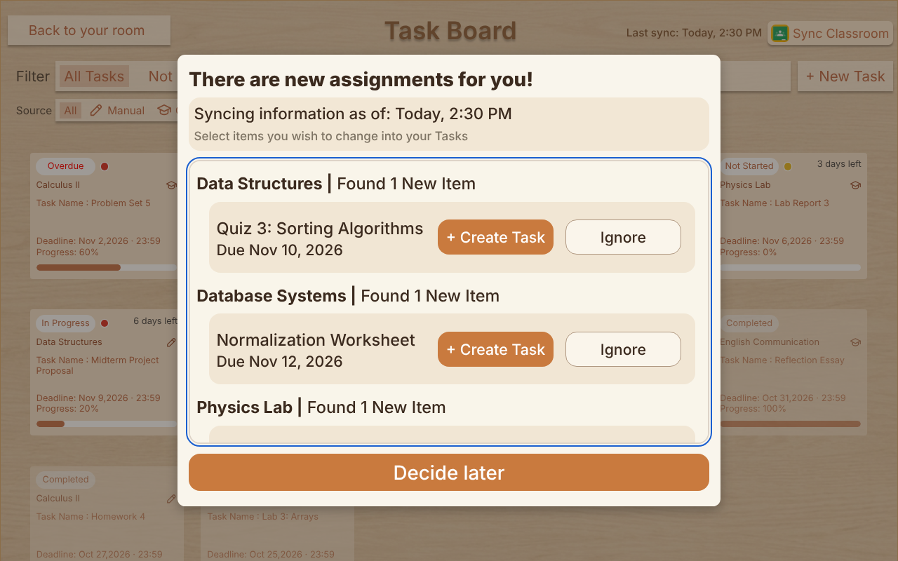
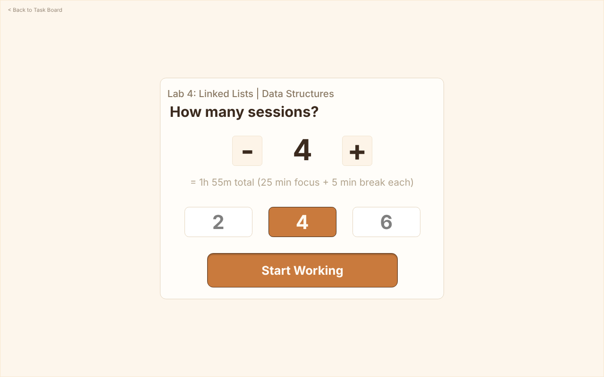
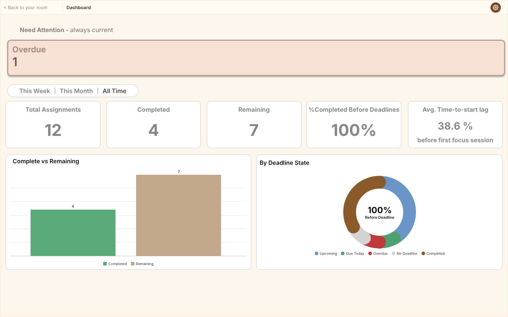
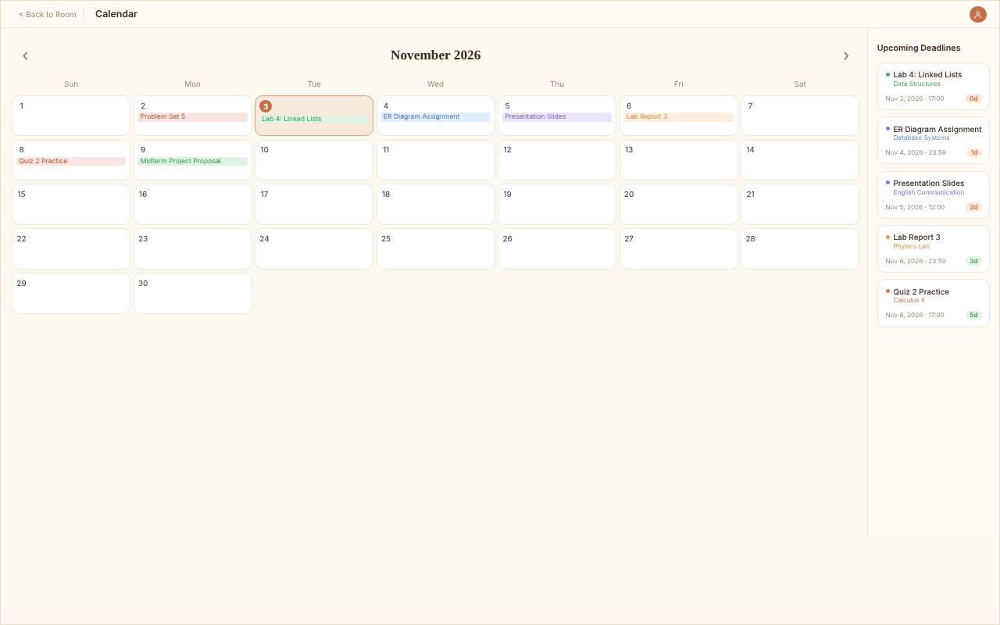
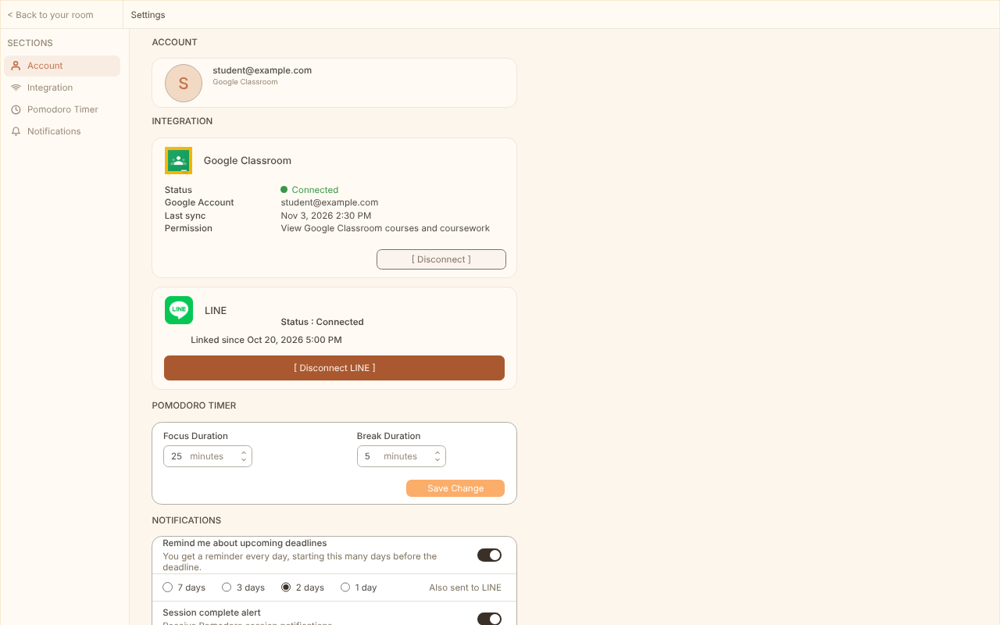
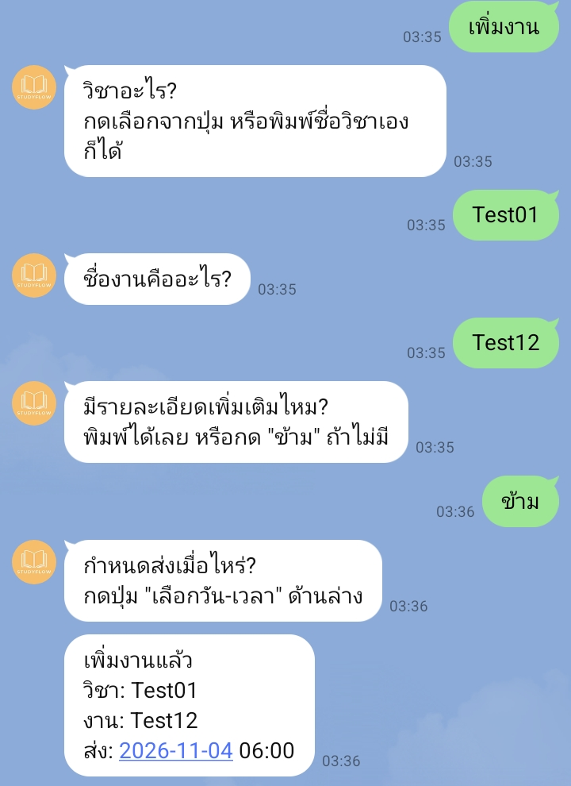
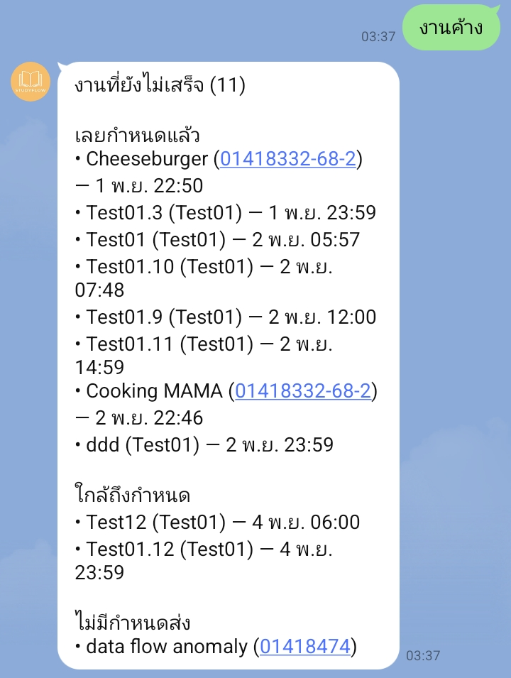
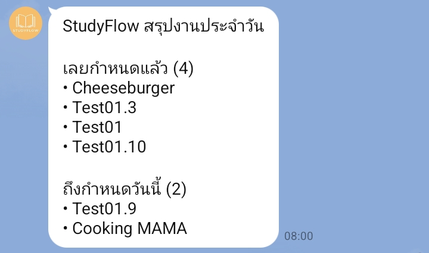

<p align="center">
  
</p>

# StudyFlow

**ระบบจัดการงานและติดตามความก้าวหน้าสำหรับนักศึกษา**
*Workload Management and Progress Tracking Systems for Students*

แอปบน Windows ที่รวมงานจากทุกรายวิชาไว้ที่เดียว ดึงงานจาก Google Classroom มาให้ เตือนก่อนถึงกำหนดส่ง และแสดงให้เห็นว่าเราเริ่มลงมือทำงานช้าหรือเร็วแค่ไหน

โครงงานวิทยาการคอมพิวเตอร์ ปีการศึกษา 2568
หลักสูตรวิทยาศาสตรบัณฑิต สาขาวิชาวิทยาการคอมพิวเตอร์ คณะศิลปศาสตร์และวิทยาศาสตร์ มหาวิทยาลัยเกษตรศาสตร์ วิทยาเขตกำแพงแสน

**[ดาวน์โหลดตัวติดตั้ง (Windows)](https://github.com/Kenshi1112/StudyFlow/releases/latest)**

---

## ภาพหน้าจอ

ข้อมูลในภาพทั้งหมดเป็นข้อมูลตัวอย่าง

<table>
  <tr>
    <td width="50%"><br><sub><b>Room</b> หน้าแรก คลิกวัตถุในห้องเพื่อไปหน้าต่างๆ วงแดงบน Task Board บอกจำนวนงานที่ต้องรีบดู</sub></td>
    <td width="50%"><br><sub><b>Task Board</b> งานทั้งหมดในที่เดียว กรองตามสถานะ แหล่งที่มา และรายวิชา</sub></td>
  </tr>
  <tr>
    <td width="50%"><br><sub><b>นำเข้าจาก Google Classroom</b> งานใหม่ที่ดึงมาจะให้เลือกก่อนว่าจะสร้างเป็น Task หรือไม่</sub></td>
    <td width="50%"><br><sub><b>Start Working</b> เลือกจำนวนรอบแล้วเริ่มจับเวลาทำงาน/พักของงานนั้น</sub></td>
  </tr>
  <tr>
    <td width="50%"><br><sub><b>Dashboard</b> สรุปภาระงานและ Time-to-Start Lag</sub></td>
    <td width="50%"><br><sub><b>Calendar</b> ดูกำหนดส่งตามวันที่ และรายการที่ใกล้ถึงกำหนด</sub></td>
  </tr>
  <tr>
    <td width="50%"><br><sub><b>Settings</b> เชื่อม Google Classroom และ LINE ตั้งเวลาจับเวลา และการแจ้งเตือน</sub></td>
    <td width="50%"></td>
  </tr>
</table>

**LINE** ใช้ผ่านมือถือได้โดยไม่ต้องเปิดคอมพิวเตอร์ (ข้อมูลในภาพเป็นข้อมูลทดสอบ)

<table>
  <tr>
    <td width="33%" valign="top"><br><sub><b>เพิ่มงาน</b> พิมพ์ "เพิ่มงาน" แล้วตอบทีละคำถาม (วิชา ชื่องาน รายละเอียด กำหนดส่ง)</sub></td>
    <td width="33%" valign="top"><br><sub><b>งานค้าง</b> พิมพ์ "งานค้าง" เพื่อดูงานที่ยังไม่เสร็จ แยกตามเลยกำหนด ใกล้ถึงกำหนด และไม่มีกำหนดส่ง</sub></td>
    <td width="33%" valign="top"><br><sub><b>สรุปงานประจำวัน</b> ส่งให้อัตโนมัติทุกเช้า 08:00 น.</sub></td>
  </tr>
</table>

---

## ดาวน์โหลดและติดตั้ง (ไม่ต้องใช้โค้ด)

ต้องใช้: คอมพิวเตอร์ **Windows 10 ขึ้นไป** (ไฟล์ติดตั้งขนาดประมาณ 120 MB)

1. เปิดหน้า [Releases](https://github.com/Kenshi1112/StudyFlow/releases/latest) แล้วดาวน์โหลดไฟล์ที่ลงท้ายด้วย `.exe` (ชื่อประมาณ `StudyFlow Setup x.x.x.exe`)
2. ดับเบิลคลิกไฟล์ที่ดาวน์โหลดมา แล้วรอจนติดตั้งเสร็จ
3. เปิดแอปจากไอคอน **StudyFlow** บน Desktop หรือใน Start Menu

**ถ้า Windows ขึ้นหน้าจอสีฟ้า "Windows protected your PC" (Windows ปกป้องพีซีของคุณ)**
ไม่ได้แปลว่าไฟล์มีไวรัส แต่เพราะตัวติดตั้งยังไม่ได้ลงลายเซ็นดิจิทัล (ซึ่งต้องเสียค่าใช้จ่าย) ให้กด **"ข้อมูลเพิ่มเติม" (More info)** แล้วกด **"เรียกใช้อยู่ดี" (Run anyway)**

- ใช้งานได้ทันทีหลังติดตั้ง **ไม่ต้องสมัครสมาชิกหรือล็อกอิน** และใช้งานได้โดยไม่ต้องต่ออินเทอร์เน็ต
- ต้องต่ออินเทอร์เน็ตเฉพาะตอนใช้ Google Classroom, LINE และสำรองข้อมูลขึ้น cloud
- ถอนการติดตั้งได้จาก Windows Settings > Apps

## ใช้งานเบื้องต้น

เมื่อเปิดแอปจะเข้าสู่ **ห้อง (Room)** ซึ่งเป็นหน้าแรก ให้คลิกที่วัตถุในห้องเพื่อไปยังหน้าต่างๆ ได้เลย

| คลิกที่ | ไปที่ | ทำอะไรได้ |
|---|---|---|
| Task Board | กระดานงาน | เพิ่ม/แก้/ลบงาน, ดูงานทั้งหมด, กด Sync Classroom เพื่อดึงงานจาก Google Classroom |
| คอมพิวเตอร์ | Dashboard | ดูภาพรวมภาระงานและพฤติกรรมการเริ่มลงมือทำงาน |
| ปฏิทิน | Calendar | ดูงานตามวันที่ |
| ปุ่ม Settings (สีส้ม) | ตั้งค่า | เชื่อม Google Classroom, เชื่อม LINE, เลือกวันที่ให้แจ้งเตือนล่วงหน้า |

**เชื่อม Google Classroom:** Settings > การ์ด Google Classroom > กด Connect แล้วเลือกวันที่เริ่มนำเข้างาน แอปจะดึงงานมาให้ตรวจสอบก่อนนำเข้าทุกครั้ง

**เชื่อม LINE:** Settings > การ์ด LINE > กด Connect LINE จะได้รหัสยืนยัน 6 หลัก ให้เพิ่มเพื่อนกับ LINE Official Account ของโปรเจกต์ (สแกน QR ในแอป หรือค้นหา LINE ID `@071apfig`) แล้วส่งรหัสนั้นไปในแชท หลังเชื่อมแล้วพิมพ์ในแชทได้ว่า
- `เพิ่มงาน` เพิ่มงานใหม่ (เลือกจากปุ่ม/ตัวเลือกวันที่ ไม่ต้องพิมพ์ยาว)
- `งานค้าง` ดูรายการงานที่ยังไม่เสร็จ
- `แก้งาน` เปลี่ยนสถานะงานเป็น Completed / In Progress หรือเลื่อนวันส่ง

## ฟีเจอร์

- **รวมงานไว้ที่เดียว** เพิ่มงานเองได้ (วิชา, กำหนดส่ง, ความสำคัญ, คำอธิบาย, โน้ต) พร้อมสถานะงานและความคืบหน้า (%) ที่ผู้ใช้กำหนดเอง
- **นำเข้างานจาก Google Classroom** ดึงอัตโนมัติทุกครั้งที่เปิดแอป และกด Sync Classroom เองได้ มีหน้าต่างให้ตรวจสอบก่อนนำเข้า และถ้าอาจารย์แก้ชื่อ/คำอธิบาย/กำหนดส่งใน Classroom งานในแอปจะอัปเดตตาม
- **เรียงงานตามความเร่งด่วน** บน Task Board โดยคำนวณจากเวลาที่เหลือ ความคืบหน้า และความสำคัญที่ผู้ใช้ตั้งไว้
- **Start Working** จับเวลาทำงาน/พัก (Pomodoro) ผูกกับงานที่เลือก มีหน้าต่างเล็กลอยแสดงเวลา และบันทึกว่าเริ่มลงมือทำงานนั้นครั้งแรกเมื่อไหร่
- **Dashboard** สรุป 6 ตัวชี้วัด รวมถึง **Time-to-Start Lag** คือระยะเวลาก่อนเริ่มลงมือทำงาน คิดเป็นร้อยละของเวลาทั้งหมดตั้งแต่บันทึกงานถึงกำหนดส่ง
- **แจ้งเตือน** บนเครื่อง และผ่าน LINE
  - งานใกล้ถึงกำหนด: เลือกได้ว่าจะเริ่มเตือนก่อนส่ง 7 / 3 / 2 / 1 วัน (ค่าเริ่มต้น 1 วัน) แล้วเตือนวันละครั้งจนถึงวันส่ง
  - งานที่ถึงกำหนดวันนี้และเลยกำหนด: เตือนตอนเปิดแอปและซ้ำทุก 1 ชั่วโมงขณะเปิดแอปอยู่
  - LINE: สรุปงานส่งให้ทุกเช้า 08:00 น. แม้ไม่ได้เปิดคอมพิวเตอร์
- **ใช้ออฟไลน์ได้** เก็บข้อมูลในเครื่อง (SQLite) และสำรองงานกับประวัติการจับเวลาขึ้น Supabase เมื่อเชื่อมบัญชี Google

### ข้อจำกัดที่ควรรู้

- ใช้ได้เฉพาะ Windows
- รองรับ Google Classroom ครั้งละ 1 บัญชี และไม่ได้ซิงค์แบบเรียลไทม์ (ดึงตอนเปิดแอปหรือกด Sync Classroom)
- ถ้างานถูกลบใน Classroom แอปจะไม่รู้ และตรวจการเปลี่ยนแปลงเฉพาะชื่อ คำอธิบาย และกำหนดส่ง
- แจ้งเตือนบนเครื่องทำงานเฉพาะตอนเปิดแอปอยู่ (ถ้าต้องการให้เตือนตอนปิดเครื่อง ใช้ LINE)
- ถ้าไม่เชื่อมบัญชี Google จะไม่มีการสำรองข้อมูลขึ้น cloud

## ผู้จัดทำ

| ชื่อ | หน้าที่ |
|---|---|
| ทศพร ศรีโชติ | Backend (`src/main/`, `supabase/`) |
| ณัฐพร ดวงเดือน | Frontend (`src/renderer/`) |

อาจารย์ที่ปรึกษาโครงงาน: อ.ดร.พีรญา ธภัทรสุวรรณ

โครงงานนี้จัดทำเพื่อเป็นโครงงานจบการศึกษาระดับปริญญาตรี

---

# สำหรับนักพัฒนา

## เทคโนโลยี

Electron + HTML/CSS/JavaScript ล้วน (ไม่ใช้ framework) + SQLite (`better-sqlite3`, เก็บในเครื่อง) + Supabase (PostgreSQL สำหรับสำรองข้อมูล, Edge Functions, `pg_cron`) + Google OAuth 2.0 / Google Classroom API + LINE Messaging API

## รันจากซอร์สโค้ด

ต้องมี Node.js 22 ขึ้นไปและ Git

```bash
git clone https://github.com/Kenshi1112/StudyFlow.git
cd StudyFlow
npm install
```

คัดลอก `.env.example` เป็น `.env` แล้วใส่ค่าจริง (ห้าม commit `.env`)

| ตัวแปร | ใช้ทำอะไร |
|---|---|
| `GOOGLE_CLIENT_ID`, `GOOGLE_CLIENT_SECRET` | OAuth client สำหรับ Google Classroom |
| `SUPABASE_URL`, `SUPABASE_ANON_KEY` | โปรเจกต์ Supabase ที่ใช้สำรองข้อมูล |

LINE Channel Access Token และ Channel Secret **ไม่ใส่ใน `.env`** ให้ตั้งเป็น Supabase Edge Function secrets แทน:

```bash
supabase secrets set LINE_CHANNEL_ACCESS_TOKEN=... LINE_CHANNEL_SECRET=...
```

```bash
npm start        # เปิดแอป
npm run dev      # เปิดแอปพร้อม DevTools
npm run build    # สร้างตัวติดตั้ง Windows ไว้ที่ dist/
node --test tests/schema.test.js   # รันเทส schema
```

หมายเหตุเรื่อง build: ตัวติดตั้งแพ็กไฟล์ `.env` เข้าไปด้วย (ตั้งไว้ใน `package.json` > `build.files`) เพื่อให้ผู้ใช้ไม่ต้องตั้งค่าเอง จึงต้องมี `.env` ก่อนสั่ง build และค่าในนั้นจะอยู่ในไฟล์ที่แจกออกไปด้วย

## เอกสาร

| ไฟล์ | คืออะไร |
|---|---|
| `docs/PROJECT_v0.21.md` | Spec หลักของโปรเจกต์ (Single Source of Truth) |
| `docs/UX-UI-Design-Review_v0.21.md` | ออกแบบหน้าจอ (ต้องตรงกับ spec) |
| `docs/ipc-contract.md` | รายการ IPC channel และ payload |
| `docs/ROADMAP.md` | แผนทำงานทีละขั้นและบันทึกความคืบหน้า |

## โครงสร้าง

```
.
├── src/
│   ├── main/                  # Backend: Electron main process
│   │   ├── main.js            # entry point เปิดหน้าต่างหลัก
│   │   ├── db/                # database.js, schema.sql, migrations/
│   │   ├── services/          # task, classroom-sync, google-auth, pomodoro, dashboard,
│   │   │                      #   notification, cloud-sync, settings
│   │   ├── ipc/               # handler ต่อ feature (ลงทะเบียนผ่าน ipc/index.js)
│   │   └── windows/           # floating-widget.js (หน้าต่างลอยของ Start Working)
│   ├── preload/               # Shared: สะพานระหว่าง renderer กับ main
│   │   └── preload.js
│   ├── renderer/              # Frontend: UI ทั้งหมด
│   │   ├── index.html
│   │   ├── router.js          # สลับหน้าแบบ hash router
│   │   ├── api-client.js      # ตัวเรียก window.api.invoke
│   │   ├── pages/             # room, task-board, dashboard, pomodoro, calendar, settings
│   │   ├── components/        # ส่วน UI ที่ใช้ซ้ำ
│   │   ├── styles/            # tokens.css, global.css
│   │   ├── assets/            # รูป/โลโก้
│   │   └── widget/            # หน้าตา floating widget
│   └── shared/                # Shared: สัญญาระหว่างสองฝั่ง
│       ├── ipc-channels.js    # รายชื่อ IPC channel
│       └── constants.js       # ค่า enum ตาม spec
├── supabase/
│   ├── migrations/            # SQL ของ Postgres บน Supabase
│   └── functions/
│       ├── line-webhook/      # ผูกบัญชี LINE + เพิ่มงาน/งานค้าง/แก้งาน
│       └── notify-check/      # สรุปแจ้งเตือน LINE ทุกเช้า (pg_cron)
├── build/                     # ไอคอนของตัวติดตั้ง
├── tests/
└── docs/
```

## กติกาของทีม

| โฟลเดอร์ | เจ้าของ | แก้ได้อย่างไร |
|---|---|---|
| `src/main/`, `supabase/` | Backend | Backend แก้ได้เลย |
| `src/renderer/` | Frontend | Frontend แก้ได้เลย |
| `src/preload/`, `src/shared/` | Shared | ต้องคุยกันก่อนแก้ |
| `tests/`, `docs/` | ตามเนื้อหา | ใครเขียนก็ใส่ได้ แต่ test ของโค้ดฝั่งไหนให้เจ้าของฝั่งนั้นรีวิว |

1. **renderer ห้ามเข้า DB ตรง** ทุกการอ่าน/เขียนข้อมูลต้องผ่าน IPC เท่านั้น: `renderer` -> `window.api.invoke(channel)` -> `preload` -> `ipc/*.ipc.js` -> `services/*` -> `db/database.js` เฉพาะ main process เท่านั้นที่แตะ SQLite (spec section 17.2)
2. **renderer ไม่ใช้ `require` / Node API** เปิดแค่ `contextIsolation: true`, `nodeIntegration: false` เรียกของฝั่ง main ผ่าน `window.api` ที่ preload เปิดให้เท่านั้น
3. **เพิ่ม/เปลี่ยน IPC channel ต้องคุยกันก่อน** ขั้นตอน: (1) ตกลง channel และ payload (2) เพิ่มใน `src/shared/ipc-channels.js` และ `docs/ipc-contract.md` (3) Backend ผูก handler ใน `src/main/ipc/` และ Frontend เรียกผ่าน `window.api.invoke` preload จะอนุญาตเฉพาะ channel ที่อยู่ในไฟล์นั้น
4. **ห้ามเพิ่ม field/feature/requirement ที่ไม่มีใน `docs/PROJECT_v0.21.md`** ถ้าจำเป็นต้องเพิ่ม ให้ขึ้นเวอร์ชัน spec ก่อนแล้วค่อยแก้โค้ด
5. **Secrets ห้าม commit** LINE token และ Channel Secret ตั้งเป็น Supabase Edge Function secrets ไม่เก็บในแอปหรือใน `.env` (spec section 18.2, 20)

branch: `main` เป็นตัวหลัก, `backend` และ `frontend` เป็น branch ทำงานของแต่ละฝั่ง แล้วเปิด PR เข้า `main`

## หมายเหตุ

- `src/main/main.js` ตั้ง `sandbox: false` เพราะ `preload.js` ต้อง `require('../shared/ipc-channels')` ส่วน renderer ยังถูกแยกด้วย `contextIsolation`
- Start Working (Pomodoro) ผูกกับงานเสมอ ไม่มี session แบบไม่ผูกงาน (spec section 15)
